# AI Job Search Agent — UI & Architecture Portfolio Showcase

This directory contains high-resolution (2x Retina, 2880x1800 desktop and 786x1704 mobile) screenshots of the **AI Job Search Agent & Interactive Application Tracker**. These visuals are curated and optimized for portfolio websites, GitHub README showcases, LinkedIn project features, and technical presentations.

---

## 📸 Screenshot Gallery

| Preview | Filename | Key Feature Demonstrated |
| :---: | :--- | :--- |
| 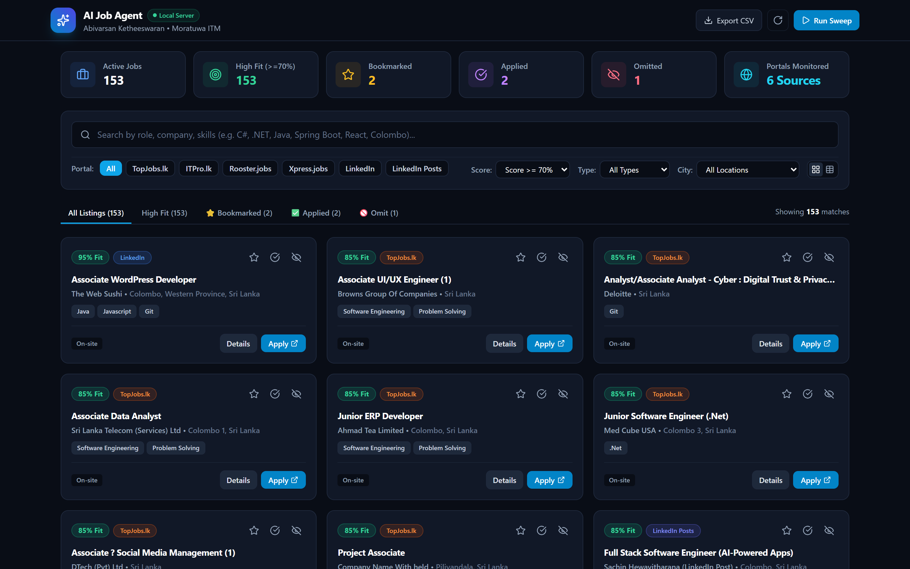 | `01_dashboard_desktop_overview.png` | **Main Desktop Dashboard & Real-Time KPIs**: High-density card grid view with active counters, portal chips, status badges, and candidate match scores. |
| 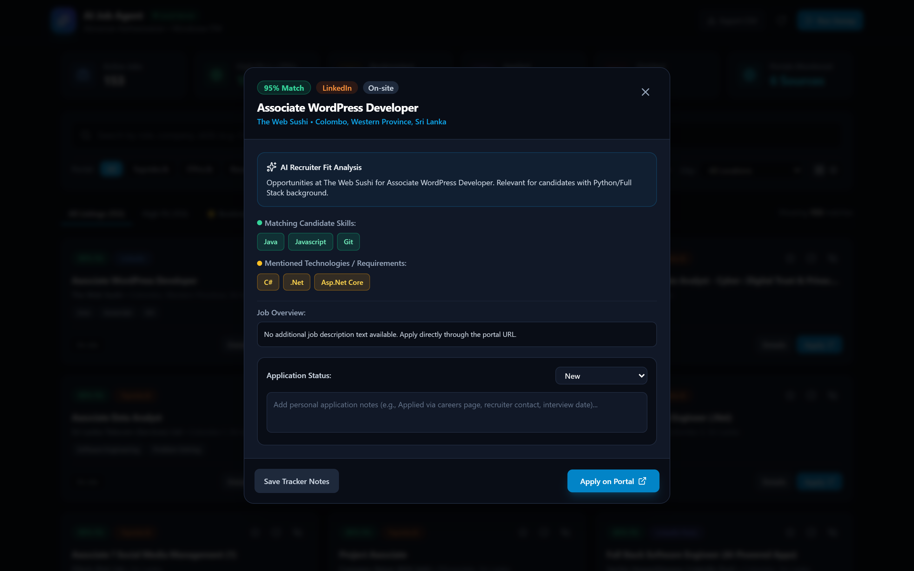 | `02_ai_evaluation_modal.png` | **Deep-Dive AI Recruiter Fit Modal**: Full match percentage, candidate matching skills (green), missing requirements (red), pros/cons, application lifecycle tracker, and notes. |
| 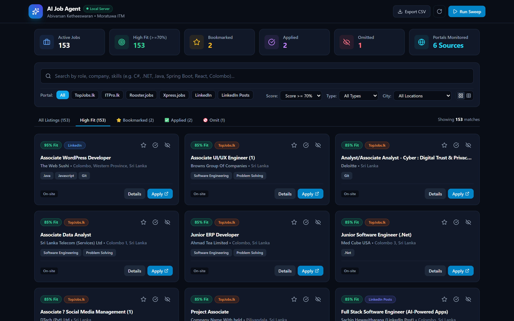 | `03_high_fit_matches_tab.png` | **High Fit (70%+ Fit) Tab**: AI recommendation engine isolating roles with strong technical alignment and high interview probability. |
| 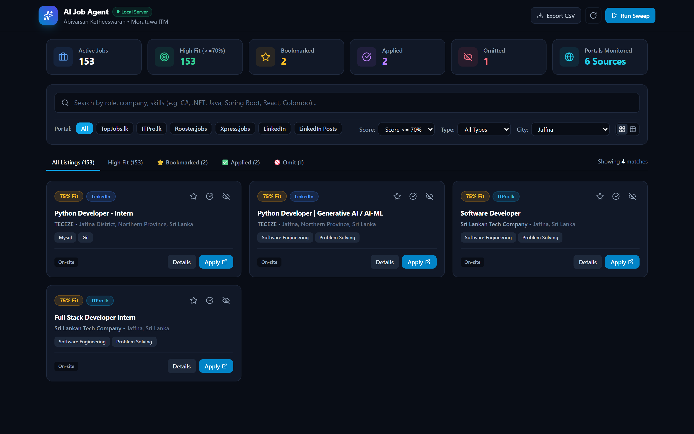 | `04_location_filter_jaffna.png` | **Regional City Filter (Jaffna)**: Normalized geographic filtering isolating Northern Province engineering opportunities. |
| 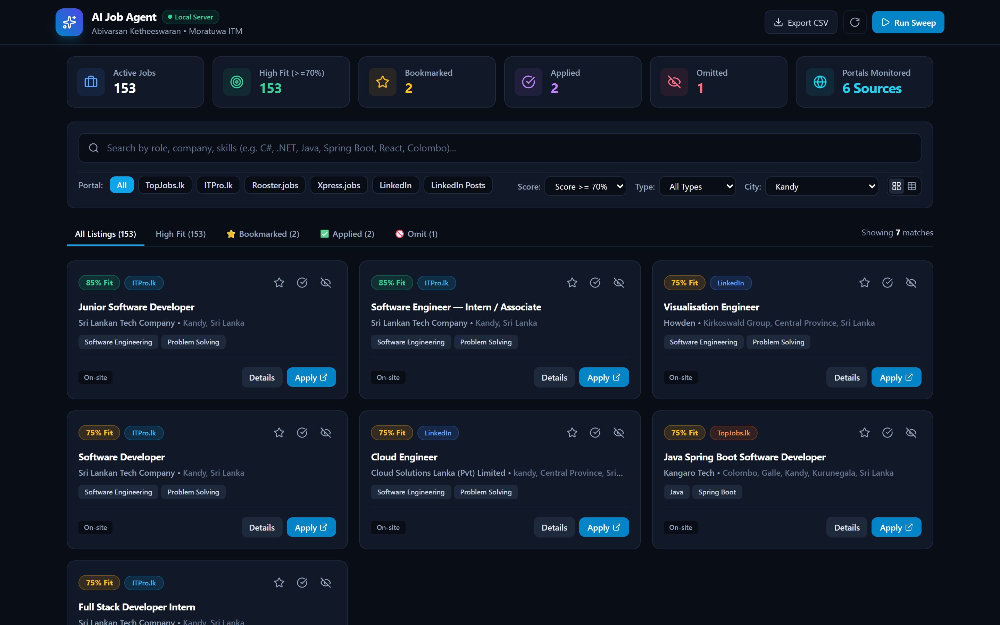 | `05_location_filter_kandy.png` | **Regional City Filter (Kandy)**: Isolating Central Province software engineering and cloud positions. |
| 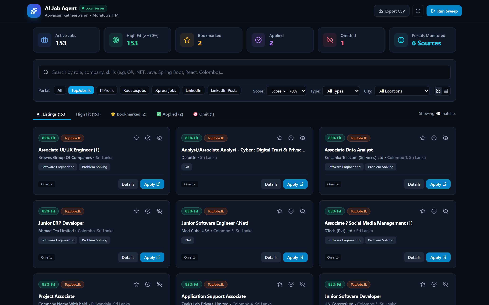 | `06_portal_filter_topjobs.png` | **Multi-Portal Scraping (TopJobs.lk)**: Direct scraping and direct-application link resolution for TopJobs Sri Lanka. |
| 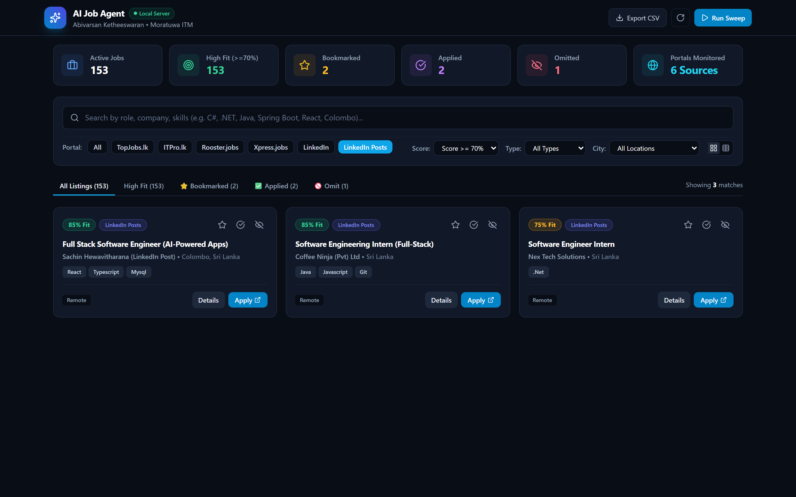 | `07_portal_filter_linkedin_posts.png` | **LinkedIn Public Feed Scraper**: Extracting hiring opportunities directly from recruiter and engineering lead feed posts (`linkedin.com/posts/...`). |
| 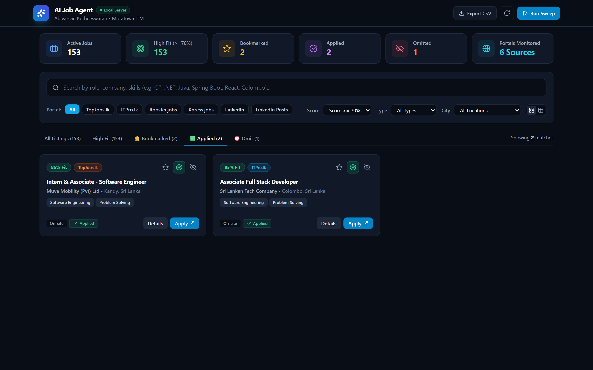 | `08_applied_pipeline_tab.png` | **Personal Application Pipeline (Applied Tab)**: Strict tab segregation showing jobs marked as Applied with candidate submission notes. |
| 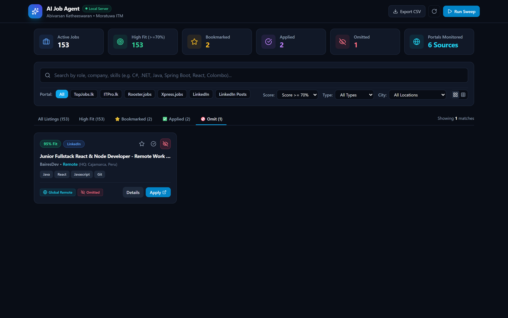 | `09_omit_management_tab.png` | **Distraction-Free Omit Management**: Segregated Omit tab keeping the primary dashboard clean while allowing 1-click restore. |
| 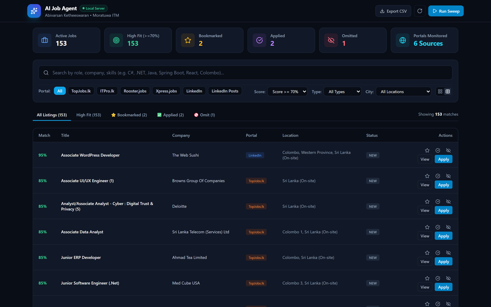 | `10_desktop_table_view.png` | **Compact Desktop Data Table**: High-density table layout with sortable columns, inline actions, and quick CSV export. |
| 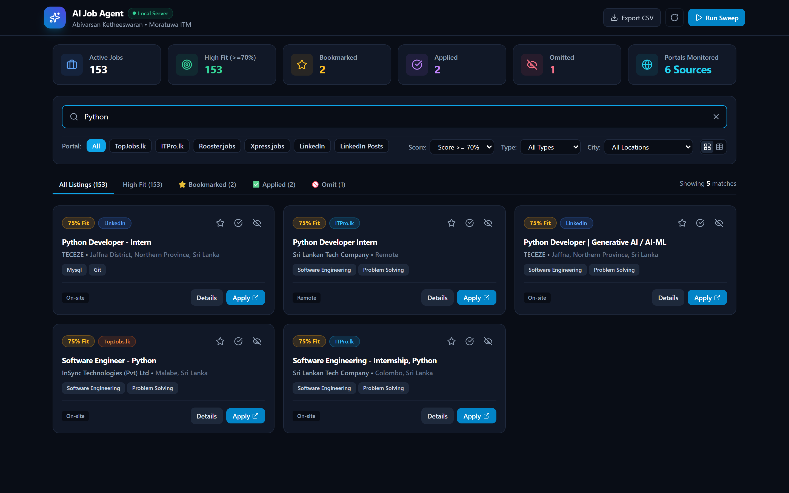 | `11_live_search_skills.png` | **Instant Live Search**: Sub-millisecond keyword filtering across titles, companies, locations, and extracted technical skills. |
| 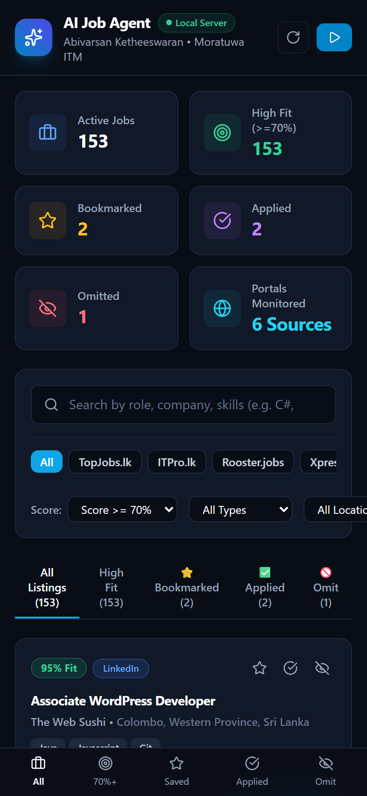 | `12_mobile_responsive_overview.png` | **Mobile-First PWA Interface**: Native smartphone experience with sticky search, touch-friendly filter pills, and bottom navigation bar. |
| 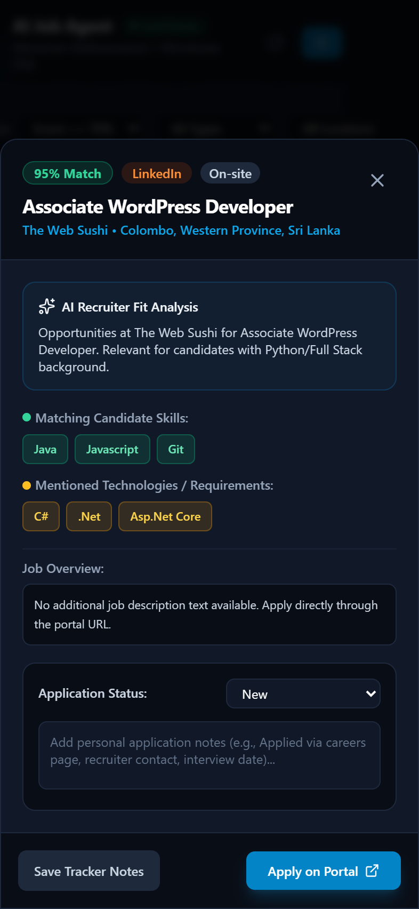 | `13_mobile_details_sheet.png` | **Mobile AI Inspection Sheet**: Native slide-up modal showing AI evaluation breakdown and application tracking on mobile screens. |

---

## 🛠️ How to Embed in Portfolio Markdown

```markdown
### Live Dashboard & AI Matching Engine


### Automated AI Candidate-Role Evaluation


### Mobile-First PWA Experience
<p align="center">
  
  
</p>
```
